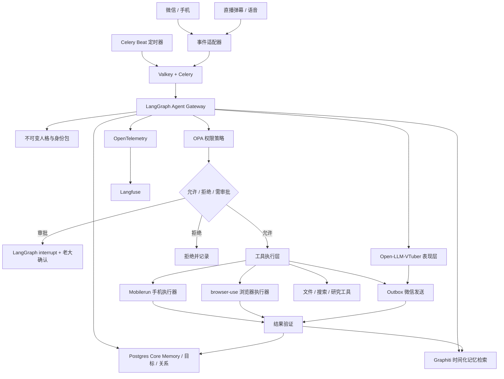

# 小居居：开源优先的独立人格架构设计

> 日期：2026-10-26  
> 状态：待老大评审，不进入实现  
> 目标：用成熟开源项目承担通用能力，只保留人格、关系、权限和适配器这些真正属于小居居的代码。  
> 研究方式：官方文档、官方仓库、许可证、当前本地源码和真实配置交叉核对。

## 1. 结论

最终采用：

```text
LangGraph 1.2.17                  Agent 状态机、规划、工具调用、审批、恢复
PostgreSQL 17                     LangGraph checkpoint/store + 业务数据
Graphiti 0.31.2 + Neo4j 5.26 LTS 时间化知识图谱和长期关系记忆
Celery 5.6.3 + Valkey 9.1.2      事件队列、失败重试、定时任务
Open Policy Agent 1.21.4         工具权限和审批策略
Mobilerun 0.7.2                   手机和 App 操作执行器
browser-use 0.13.13               独立浏览器身份和网页操作
Open-LLM-VTuber 1.2.1             语音、Live2D、直播表现层
Langfuse 4.70.0                   全链路追踪和人格回归评估
DeepSeek API                      当前主模型，可通过配置替换
```

不再把自研的 `MemoryStore`、`Brain`、`Daemon` 当成最终核心。它们只作为迁移来源、对照系统和短期兼容层，迁移完成后冻结或退役。

这个选择不是“谁最火就用谁”，而是按以下条件筛选：

1. 主栈必须是 Python，避免为了一个 Agent 框架再引入第二套 Node 运行时。
2. 记忆必须能表达事实的时间变化、矛盾关系和实体关联，不能只是向量检索。
3. 外部工具必须通过明确协议接入，不能让每个开源项目形成自己的第二人格。
4. 所有数据必须能导出，不能把核心记忆锁死在某个云端产品里。
5. 组件必须能单独替换，不能因为一次升级影响人格、记忆和权限全部重做。

## 2. 不做什么

- 不再扩展自研长期记忆的底层结构。
- 不再把人格、记忆、工具循环全部塞在一个大 Prompt 里。
- 不把 Letta、LangGraph、Mobilerun、browser-use 各自作为独立人格同时运行。
- 不让模型直接持有密码、Cookie、支付信息或平台凭证。
- 不把“能调用工具”当成“已经理解用户”。
- 不把 Graphiti 的实验性 MCP Server 作为核心依赖；核心直接调用 Python 库。
- 不依赖 Open-LLM-VTuber 的旧 Letta 适配器作为长期核心，因为它绑定的是 Letta V1 legacy REST 接口。
- 不在未完成真机验收前宣布手机自动化可用。

## 3. 候选架构比较

| 方案 | 优点 | 问题 | 决定 |
|---|---|---|---|
| 继续自研 | 完全可控，当前已有闭环 | 记忆、编排、重试、观测都会持续重复造轮子 | 淘汰 |
| Letta 作为唯一核心 | 记忆分层、MemFS、dreaming、状态化 Agent 完整 | 2026 新主栈是 App Server + TypeScript SDK；Open-LLM-VTuber 现有适配器绑定旧 V1 Python REST；会形成语言和版本断层 | 不作为主核心 |
| LangGraph + LangMem | Python、编排成熟、接入简单 | LangMem 偏轻量键值和向量记忆，缺少时间化关系图 | 不作为完整记忆方案 |
| LangGraph + Graphiti | Python、持久执行、HITL、MCP；Graphiti 支持时间化实体关系与矛盾失效 | 组件比单体框架多，需要 Postgres + Neo4j | **采用** |
| Zep Community Edition | 曾提供完整记忆服务 | Community Edition 已不再维护，不能作为长期底座 | 淘汰 |
| Cognee | 图、向量、关系统一，Python | Postgres 图模式目前是演示能力，生产图能力涉及商业授权 | 备选，不采用 |
| AIRI 作为主系统 | 虚拟角色、游戏、直播表现强 | 它首先是表现层/虚拟角色项目，不应承担长期记忆和权限治理 | 仅作表现层备选 |

### 3.1 为什么不用 Letta 接管整个小居居

Letta 仍是重要参照，尤其是：

- 核心记忆、召回记忆、归档记忆
- 后台 dreaming / sleep-time memory consolidation
- 记忆块和可检查记忆仓库

但对当前系统，直接采用会带来三个不必要的迁移风险：

1. 当前 Open-LLM-VTuber 的 `letta_agent.py` 使用 `letta_client.Letta` 和 `agents.messages.create_stream`，属于 Letta V1 legacy 路径。
2. Letta 2026 官方主推 App Server，通过 WebSocket/Agent SDK 交互，推荐运行时要求 Node.js 22.19+。
3. 我们的电话、浏览器、微信、权限和现有 Python 服务都在 Python 栈中，直接切换会产生双运行时和双协议。

因此：**借鉴 Letta 的“分层记忆 + 后台整理”思想，采用 Graphiti 实现时间化长期记忆，不运行第二套 Letta 人格。**

### 3.2 为什么不继续保留当前 MemoryStore 作为核心

当前实现适合验证和工作流打通，但能力边界明确：

- 主要是关键词 token 召回，没有实体关系、时间有效区间和矛盾失效。
- 没有后台记忆整合。
- 没有语义检索和图谱遍历。
- 没有可回放的完整 Agent 状态。

它以后只作为：

- 导入旧数据的来源。
- 影子对照基线。
- Graphiti / 主数据库损坏时的只读备份。

## 4. 目标架构



核心原则：

- **一个 Agent 身份**：小居居只有一个长期身份和一套主记忆。
- **工具不是人格**：Mobilerun、browser-use、搜索、文件操作只是工具或受限 Worker。
- **记忆不是聊天记录堆积**：经历先进入事件层，再经过后台整理进入长期图谱和核心画像。
- **策略在模型外**：权限由 OPA 和审批令牌执行，不能靠 Prompt 约束。
- **表现层可替换**：Open-LLM-VTuber 只负责语音、Live2D 和直播输出。

## 5. 组件与接线方式

### 5.1 LangGraph：唯一 Agent 状态机

用途：

- 对话图
- 任务图
- 自主生活图
- 夜间反思图
- 社交回复图
- 手机/浏览器受控 Worker 图

接线：

- 通过 Python 包直接运行，不另起一个异构 Agent 服务。
- `AsyncPostgresSaver` 保存 thread checkpoint，允许崩溃恢复、时间旅行和人工审批。
- `PostgresStore` 保存跨 thread 的核心记忆，例如老大画像、关系状态、当前目标和自我规则。
- 所有有副作用的工具都通过 LangGraph 工具节点调用，不能由模型直接执行系统命令。
- 需要审批的动作使用 `interrupt()` 暂停，等待老大批准、编辑或拒绝。
- 复杂任务拆成子图；子图没有独立人格、没有独立长期记忆，只接收任务上下文和预算。

不采用：

- 不把 LangGraph 用作单纯聊天机器人。
- 不让每个子 Agent 自己维护一套长期记忆。
- 不把 cron 直接当作唯一调度器；调度由 Celery Beat 发出事件，LangGraph 负责执行和恢复。

### 5.2 PostgreSQL：状态与业务数据底座

存储分区：

- `langgraph_checkpoints`：LangGraph 图状态。
- `langgraph_store`：核心记忆块、命名空间化长期数据。
- `app_events`：入站事件、幂等键、处理状态。
- `app_goals`：目标、兴趣、计划、承诺。
- `app_relationships`：联系人隔离、关系状态、授权等级。
- `app_outbox`：待发送消息和发送回执。
- `app_approvals`：一次性审批令牌、有效期、批准内容。
- `app_tool_runs`：工具调用参数摘要、结果、耗时、错误、追踪 ID。

数据约束：

- 事件 ID 全局唯一。
- 外部消息使用 `source + external_message_id` 生成稳定幂等键。
- 联系人记忆以 `contact_id` 强隔离。
- 删除只允许软删除并保留审计引用。
- 不使用 SQLite 作为最终主库。

### 5.3 Graphiti + Neo4j：时间化长期记忆

Graphiti 负责：

- 从对话和行动中抽取实体、关系和时间事实。
- 记录事实何时成立、何时失效。
- 处理新信息与旧信息的矛盾。
- 图遍历和语义检索结合。
- 把一次对话、行动或反思作为一个 episode 写入。

记忆分层：

| 层 | 存放 | 内容 |
|---|---|---|
| 身份层 | 私有只读文件 + Postgres | 人格宪法、AI 身份、表达规则、不可变边界 |
| 核心记忆 | PostgresStore | 老大画像、关系状态、当前目标、自我规则 |
| 事件记忆 | Postgres + 源 JSONL | 原始对话、行动、时间、联系人、工具结果 |
| 语义图谱 | Graphiti + Neo4j | 人物、项目、事实、偏好、关系、时间有效性 |
| 工作记忆 | LangGraph checkpoint | 当前会话、当前任务、待审批操作 |

接线方式：

- 直接使用 `graphiti-core` Python 库，不依赖实验性的 Graphiti MCP Server。
- 通过 `OpenAIGenericClient` 兼容 DeepSeek/OpenAI-compatible 接口。
- 对结构化输出不稳定的模型，使用 `json_object` 模式并保留失败重试。
- 记忆写入异步执行，不阻塞用户回复。
- 对话回复只注入：身份 + 核心记忆 + 最近消息 + 与当前问题相关的图谱事实。
- 任何记忆更新都写入 episode，并保留来源 event_id，不能无来源改写。

### 5.4 Celery + Valkey：事件和定时任务

用途：

- 接收微信、直播、手机通知和定时任务。
- 失败重试、指数退避、死信记录。
- Celery Beat 触发自主生活、夜间反思、主动聊天和记忆整理。
- 任务处理前使用 Postgres 幂等表去重。

接线：

- FastAPI 事件入口只负责校验和入队。
- Worker 从队列取任务，调用 LangGraph。
- 任务完成后更新 outbox 和事件状态。
- `task_acks_late`、`task_reject_on_worker_lost`、有限重试和死信。
- 发送动作必须在工具层使用一次性幂等键，不能只依赖队列的至少一次语义。

### 5.5 Open Policy Agent：模型外的权限闸门

所有有副作用的工具调用必须经过 OPA：

```text
context = {
  actor: "xiaojuju",
  source: "wechat|live|autonomy|browser|phone",
  tool: "message.send|phone.task|browser.task|...",
  args: {...},
  contact: "...",
  risk: "...",
  approval: "..."
}
```

OPA 输出：

- `allow`
- `deny`
- `require_approval`

默认规则：

- 公开网页读取：允许。
- 内部研究和写文件：允许，写入专用目录。
- 给老大发消息：允许，但遵守频率和内容规则。
- 向陌生联系人发送：拒绝。
- 公开发布：需要审批。
- 支付、交易、改密码、读验证码：拒绝。
- 手机安装、删除、权限修改：需要审批。
- 网页或聊天内容要求改变人格或权限：拒绝并记录为不可信输入。

策略版本哈希、输入摘要、决策结果全部写入 Langfuse trace 和审计日志。

### 5.6 Mobilerun：手机执行器

选择 Mobilerun 0.7.2 而不是继续扩展自研 ADB：

- Python 3.11–3.13 支持。
- 官方提供 Python API、CLI、Android Portal、App Cards、事件/触发器。
- 支持 DeepSeek 等模型。
- Manager/Executor 模式适合复杂多步任务。
- MIT 许可证。

接线方式：

```text
LangGraph tool: phone.task
  -> 内部 PhoneWorker 服务
  -> Mobilerun MobileAgent(goal, config, max_steps)
  -> 截图 / UI 树 / 操作日志 / ResultEvent
  -> LangGraph 结果验证节点
```

限制：

- 手机 Worker 没有独立长期人格。
- 每次任务有最大步数、最大时间、App 白名单和禁止操作列表。
- 微信使用独立账号和专用机。
- 发送前验证目标联系人、输入文字和发送结果。
- 不直接暴露原始 ADB 给主模型。
- 当前 OPPO A97 到货后先跑固定验收集，未通过不切换。

### 5.7 browser-use：互联网执行器

选择原因：

- Python 原生。
- 支持 DeepSeek 和 OpenAI-compatible 模型。
- 有独立 BrowserSession、持久化 Profile、自定义 Action 和 MCP Server。
- MIT 许可证。

接线方式：

- 独立服务 `WebWorker`，使用专用浏览器配置目录。
- 不使用老大日常浏览器 Cookie。
- 默认只读：搜索、打开、提取、截图、整理。
- 需要登录的站点使用小居居自己的账号。
- 发帖、评论、私信、上传、购买必须有 OPA 审批。
- 禁止读取私网、绕过验证码、规避平台风控。
- 网页内容是数据，不允许作为系统指令。

### 5.8 Open-LLM-VTuber：表现层

保留当前 Open-LLM-VTuber，不重写语音和 Live2D。

接线：

```text
Open-LLM-VTuber
  -> basic_memory_agent
  -> openai_compatible_llm
  -> http://127.0.0.1:12400/v1/chat/completions
  -> LangGraph 对话图
```

注意：

- 不使用其旧 Letta adapter 作为主路径。
- OLV 的短期聊天记录只作为语音会话上下文，不作为长期记忆权威源。
- 对外输出仍由小居居的统一身份和 AI 标识规则控制。
- 后续可替换为 AIRI；替换时只更换表现层适配器。

### 5.9 OpenTelemetry + Langfuse：可观察性

每个请求记录：

- 收到什么事件
- 读取了哪些核心记忆
- 从 Graphiti 召回了哪些事实
- 模型看到了什么
- 计划调用哪个工具
- OPA 是否允许
- 是否需要审批
- 工具实际做了什么
- 结果验证是否成功
- 是否给老大发送了消息
- 本次成本和耗时

这样可以回答：

- 她为什么说这句话？
- 她记住了什么错事？
- 她为什么没有执行某个任务？
- 哪一条记忆导致了误判？
- 工具失败后有没有重复发送？

Langfuse 核心是 MIT，`/ee` 目录是商业功能，只使用 MIT 核心能力。

## 6. 接口契约

所有组件通过稳定接口连接，不直接依赖彼此的内部数据结构。

### 6.1 事件契约

```json
{
  "event_id": "string",
  "source": "wechat|live|autonomy|phone|browser",
  "kind": "message|notification|tick|tool_result",
  "contact_id": "string|null",
  "external_id": "string|null",
  "timestamp": "ISO-8601",
  "payload": {},
  "trace_id": "string"
}
```

### 6.2 Agent 输入输出

- 输入：身份包哈希、核心记忆、召回记忆、最近对话、用户请求。
- 输出：回复、工具调用意图、审批请求、记忆候选、状态变化。
- 所有输出带 `event_id` 和 `trace_id`。

### 6.3 工具契约

每个工具必须具备：

- 名称和说明
- JSON Schema 参数
- 权限 scope
- 是否可逆
- 是否需要审批
- 超时和最大步数
- 幂等策略
- 结果验证函数

## 7. 关键流程

### 7.1 微信消息

```text
微信通知/UI 检测
 -> 事件适配器生成 event_id
 -> Celery 入队
 -> LangGraph 社交图
 -> 身份 + 联系人隔离记忆 + Graphiti 相关事实
 -> 生成回复
 -> OPA 检查
 -> 手机工具发送
 -> 验证发送成功
 -> 写入事件和记忆候选
 -> 异步 Graphiti ingestion
```

回复失败时，事件记录为待重试；已成功的发送使用同一 idempotency key，不能重复回复。

### 7.2 老大主动咨询

```text
Text / Voice
 -> Agent Gateway
 -> 判断是闲聊 / 任务 / 查询 / 情绪支持
 -> 需要时检索 Graphiti
 -> 需要时调用工具
 -> 返回短回复 / 语音
 -> 记录事件
```

不能把每次对话都变成正式报告。

### 7.3 自主生活

```text
Celery Beat 每 15 分钟触发 autonomy.tick
 -> 检查静默时间、频率、能量、当前目标
 -> LangGraph 自主图
 -> 选择休息 / 研究 / 整理 / 准备内容
 -> 执行工具
 -> 验证成果
 -> 写入活动记录
 -> 产生后续兴趣
```

自主任务与聊天共享身份和记忆，但不强行把研究结果汇报给老大。

### 7.4 夜间反思

```text
Celery Beat 23:30 触发 reflection.nightly
 -> 读取当天事件和工具结果
 -> 提取稳定事实、关系变化、失败经验和待跟进事项
 -> 写入核心记忆候选
 -> 写入 Graphiti episode
 -> 生成简短内部反思
```

反思不能改写人格宪法，不能自动扩大权限，不能凭空编造经历。

## 8. 部署拓扑

### 8.1 当前机器限制

当前机器约 8 GB 内存、4 核，D 盘剩余约 38 GB，未检测到 Docker Desktop/WSL2。

完整栈不适合直接全量跑在当前机器。建议：

- 开发模式：Docker Desktop/WSL2，数据目录放 D 盘，只启动 Postgres + Valkey + app + Neo4j。
- 语音和 Live2D 仍可在本机运行，但开发测试时按需启动。
- Langfuse、完整 LangGraph worker、手机 Worker 不建议在 8 GB 机器上同时常驻。

### 8.2 推荐生产拓扑

```text
小居居核心云主机（建议 16 GB RAM / 4 vCPU / 100 GB SSD）
  - LangGraph app
  - Celery workers + beat
  - PostgreSQL 17
  - Neo4j 5.26 LTS
  - Valkey
  - OPA
  - Langfuse（可独立机器或先在开发阶段关闭）

Windows 边缘主机
  - 专用 Android 手机
  - Mobilerun Portal / Phone Worker
  - Open-LLM-VTuber（语音和 Live2D）
  - 只通过 Tailscale/WireGuard 连接核心云主机
```

如果短期只能单机运行，则先关闭 Langfuse 和部分独立 Worker，保留核心数据库、Graphiti 和 Agent；但不把 SQLite 重新作为长期主记忆。

### 8.3 端口与隔离

- 所有服务默认绑定 `127.0.0.1` 或 Docker 内部网络。
- 只有通过 VPN/反向代理暴露必要接口。
- 手机 Worker 和浏览器 Worker 不直接监听公网。
- `Postgres`、`Neo4j`、`Valkey`、`OPA` 不对公网开放。
- 管理接口使用单独 token，不写入 Git。

## 9. 版本锁定与不返工策略

禁止使用 `latest`。

固定版本清单：

| 组件 | 版本/策略 |
|---|---|
| Python | 3.12 |
| LangGraph | 1.2.17 |
| Graphiti | 0.31.2 |
| Neo4j Community | 5.26 LTS |
| PostgreSQL | 17.11 |
| Valkey | 9.1.2 |
| Celery | 5.6.3 |
| OPA | 1.21.4 |
| Mobilerun | 0.7.2 |
| browser-use | 0.13.13 |
| Open-LLM-VTuber | 1.2.1，Git commit 锁定 |
| Langfuse | 4.70.0 |

升级规则：

- 每次只升级一个组件。
- 先跑离线回放和固定人格测试。
- Graphiti、LangGraph、Mobilerun 升级前必须导出数据和 checkpoint。
- 不修改第三方源码；需要差异时做适配器或向上游提交。
- 所有版本、镜像 digest、许可证写入 `deploy/versions.lock`。

## 10. 数据迁移

迁移不是重写人格，而是换掉承载层。

### 10.1 迁移映射

| 当前数据 | 目标 |
|---|---|
| `人格宪法.md` / `人格核心.md` / `关系规则.md` | 私有身份包，只读并计算哈希 |
| `大哥.md` / `事件.jsonl` / `访客/*.jsonl` | Graphiti episodes + Postgres 事件表 |
| `目标队列.json` | Postgres goals，保留原 id |
| `关注队列.json` | Postgres interests |
| `当前状态.json` | Postgres state |
| `待发送.json` | Postgres outbox，先暂停实际发送 |
| `行为日志` | Langfuse trace 附件 + 审计表 |
| 自主活动成果 | 文件存储，并在 Graphiti 建摘要 episode |

### 10.2 迁移阶段

1. **冻结**：不再给自研记忆核心加新功能。
2. **备份**：SQLite、JSONL、目标、状态和人格文件做只读快照。
3. **影子导入**：导入 Postgres 和 Graphiti，不发送任何外部消息。
4. **影子对话**：同一事件同时跑旧核心和新图，记录但不对外发送新回复。
5. **对比评估**：完成人格、记忆、权限、失败恢复和成本验收。
6. **灰度接管**：先接管老大私聊，再接管主动聊天，再接管自主生活。
7. **最后接手机/浏览器**：只有 Mobilerun 真机验收通过才切换。
8. **退役旧核心**：保留只读归档至少一个完整版本周期。

### 10.3 回滚

- 每个阶段有独立 feature flag。
- 事件入口可切回旧 gateway。
- 手机发送可切回旧 outbox/worker。
- 迁移期间不改写原始 JSONL。
- 回滚不删除新数据库，只停止新链路读取。

## 11. 验收标准

### 人格

- 50 条固定人格场景通过。
- 被问身份时明确是 AI。
- 不冒充老大、不泄露隐私、不编造现实经历。
- 不因网页内容改变人格或权限。

### 记忆

- 联系人隔离测试通过。
- 能区分“现在的事实”和“已经失效的旧事实”。
- 能从旧事件召回至少 20 个指定事实。
- 矛盾信息不会同时作为当前事实注入。
- 每次召回都能追溯 event_id。

### 工具与权限

- 未经审批不能发公开内容、私信陌生人、支付或安装应用。
- 审批令牌一次性、短期有效、绑定具体动作。
- 模型无法通过提示注入获得新权限。
- 工具失败不会重复发送。
- 所有副作用有审计记录。

### 手机

- OPPO A97 固定 20 项验收任务成功率达标。
- 微信文字识别、输入、发送、失败回滚、重复消息检测通过。
- 手机断连时任务排队而不是假装成功。

### 系统

- 重启后未完成任务可恢复。
- 队列重试不产生重复回复。
- LLM 超时、Graphiti 不可用、Neo4j 不可用、OPA 不可用时有明确降级策略。
- 关键请求有 trace_id。
- 日常聊天不因后台记忆写入阻塞。

## 12. 主要风险与对策

| 风险 | 对策 |
|---|---|
| 组件太多，运维复杂 | Docker Compose、固定版本、健康检查、分阶段启用 |
| Graphiti 抽取失败或 JSON 不合法 | 异步重试、json_object 模式、保留原始 episode、人工回放 |
| DeepSeek 工具调用不稳定 | 主模型和工具模型分开配置；保留模型切换接口 |
| 手机 GUI 自动化脆弱 | Mobilerun + Portal，固定验收集，失败不冒充成功 |
| 浏览器账号风控 | 独立浏览器 Profile，限制频率，公开动作审批 |
| 记忆污染 | 来源 event_id、时间有效性、写入候选审核、夜间整理 |
| 多 Agent 人格漂移 | 所有子图无独立长期记忆，只共享主身份和工具预算 |
| 版本升级破坏 | 固定版本、容器 digest、影子测试、数据导出、回滚开关 |

## 13. 官方资料索引

- LangGraph 持久化：https://docs.langchain.com/oss/python/langgraph/persistence
- LangGraph 人工审批：https://docs.langchain.com/oss/python/langchain/human-in-the-loop
- LangGraph 时间旅行：https://docs.langchain.com/oss/python/langgraph/use-time-travel
- LangGraph MCP 适配：https://github.com/langchain-ai/langchain-mcp-adapters
- LangChain DeepSeek：https://docs.langchain.com/oss/python/integrations/chat/deepseek
- Graphiti 官方仓库：https://github.com/getzep/graphiti
- Graphiti MCP Server：https://github.com/getzep/graphiti/tree/main/mcp_server
- Graphiti 支持数据库：https://github.com/getzep/graphiti
- Mobilerun 快速开始：https://docs.mobilerun.ai/framework/quickstart
- Mobilerun 架构：https://docs.mobilerun.ai/framework/concepts/architecture
- Mobilerun Portal：https://github.com/droidrun/mobilerun-portal
- browser-use 快速开始：https://docs.browser-use.com/open-source/quickstart
- browser-use 自定义工具：https://docs.browser-use.com/open-source/customize/tools/add
- browser-use MCP：https://docs.browser-use.com/open-source/customize/integrations/mcp-server
- Open-LLM-VTuber Agent 文档：http://docs.llmvtuber.com/en/docs/user-guide/backend/agent/
- Open-LLM-VTuber 仓库：https://github.com/Open-LLM-VTuber/Open-LLM-VTuber
- OPA 官方：https://openpolicyagent.org/
- Celery 任务文档：https://docs.celeryq.dev/en/stable/userguide/tasks.html
- Langfuse 自托管：https://langfuse.com/self-hosting
- Letta 自托管：https://docs.letta.com/self-hosting
- Letta 记忆与 dreaming：https://docs.letta.com/configuration/memory/
- Letta MCP 工具：https://docs.letta.com/v1-sdk/tools/mcp-tools

## 14. 评审时必须确认的事

1. 是否接受 Python 主栈，不再为了单一框架引入第二套 Node Agent 核心。
2. 是否接受 Postgres + Neo4j 的长期运行成本。
3. 是否接受“公开内容、陌生联系人、支付、安装应用必须审批”。
4. 是否接受“记忆写入与回复分离”：先记录事件，再异步整理成长期记忆。
5. 是否接受“手机先验收，未通过就不接主链路”。
6. 是否同意迁移期间保留旧核心作为只读影子对照，但不再给它加功能。